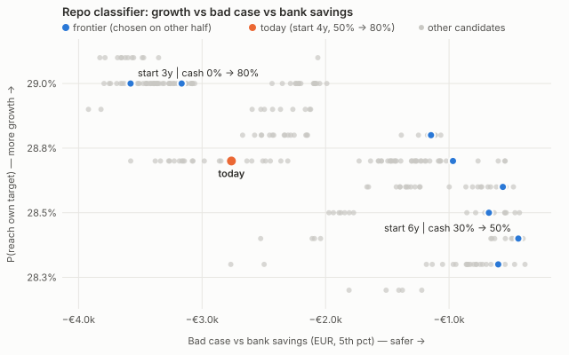
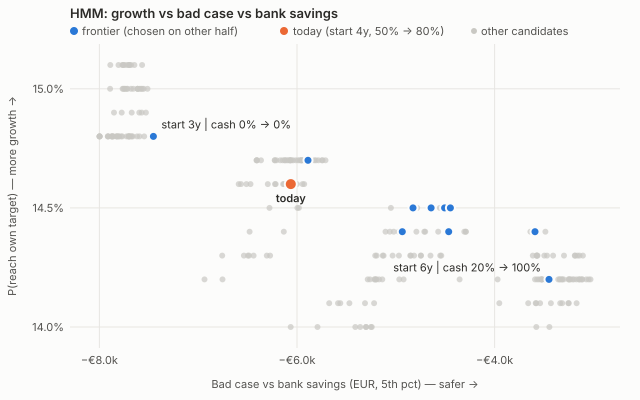
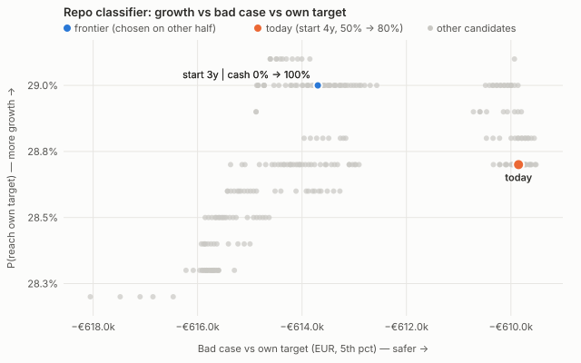
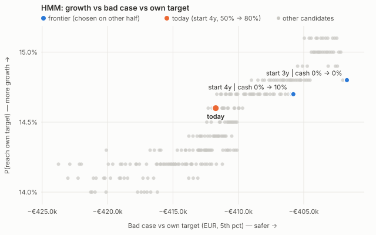

# Study: when to convert to cash (growth vs safety)

**Question.** Is there a better cash-conversion schedule than today's (start 4 years before purchase,
50% cash, then 80% in the last 2 years)? For example, is 60% cash 2 years before better than 80%?

**Method** ([METHODS.md §10](METHODS.md)). Grid search over 264 schedules: conversion start 6/5/4/3 years
before purchase × cash share in the conversion phase (0–100%) × cash share in the last 2 years (0–100%,
never lower). Each schedule is run on all 200 bootstrap re-calibrations × 500 paths, with the same random
paths for every schedule, under both regime methods. The frontier is chosen on half of the re-calibrations
and checked on the other half. Saver: €60k income, €400k house, €550/month, 10 years.
Full tables: [STUDY_CASH_FRONTIER_TABLES.md](STUDY_CASH_FRONTIER_TABLES.md). Raw results: `studies/output/`.

## Findings

**1. The cash-conversion schedule barely matters for this saver.** Across all 264 schedules:

| | Repo classifier | HMM |
|---|---|---|
| P(reach own target), range | 28.2% – 29.1% | 14.0% – 15.1% |
| Today's schedule | 28.7% | 14.6% |
| Bad case vs own target (5th pct), range | −€618k to −€610k | −€424k to −€402k |
| Bad case vs bank savings (5th pct), range | −€3.9k to −€0.4k | −€8.0k to −€3.0k |

**2. 60% vs 80% cash in the last 2 years: no meaningful difference.** With start 4 years and 50% cash
before, moving the last phase from 80% to 60% changes P(reach target) by 0.0 pp (median, both methods) and the
bad case vs bank by +€50 to +€120. Over the whole grid, more cash in the last 2 years lowers success by at most
~0.2 pp. In this model, cash and short bonds behave almost identically over 2 years.

**3. The only lever that shows up consistently is *when* conversion starts** (averages over all schedules
with that start, held-out half):

| Start | Δ P(reach target) vs today | Δ bad case vs bank | Safer than today in |
|---|---|---|---|
| 6 years | −0.4 pp | +€1.7k (repo) / +€2.7k (HMM) | 89% / 85% of re-calibrations |
| 5 years | −0.2 pp | +€1.0k / +€1.3k | 89% / 84% |
| 4 years (today) | +0.1 pp | ±€0.1k | — |
| 3 years | +0.4 pp / +0.5 pp | −€0.6k / −€1.6k | 31% / 24% |

Earlier conversion buys a little safety for a little growth; later conversion the reverse. Both effects are
small (≤ 0.5 pp, ≤ €3k).

**4. The exact frontier is not stable.** The schedules on the frontier differ between the selection and
held-out halves (overlap 0.0–0.2), so ranking individual schedules is mostly noise. Only the direction in
finding 3 is robust. Today's schedule is not on the frontier, but it is within noise of it.

## Why it is so flat

* **The target, not the pot, decides success.** Whether the saver reaches the deposit depends mainly on house
  prices and mortgage rates. The pot (median ~€93k) is far below the median target (~€207k, repo), so slightly
  better or worse returns rarely flip the outcome. The bad case vs own target is set by the target's tail
  (−€400k to −€600k), which no allocation can move.
* **The grid only swaps low-risk assets.** Within the conversion phase it trades cash against short bonds and
  protected equity, never against plain equity (limitation I1). The real growth-vs-safety lever (how long to
  hold equity) was outside this grid.

## What this means

* For this saver, keep today's schedule. 60% vs 80% cash is a product-design choice, not an outcome driver.
* A saver near the margin (pot ≈ target, e.g. a cheaper home) would probably show a steeper trade-off; not
  tested here (limitation I2).
* The next useful experiment is to let **equity** be part of the remainder, i.e. vary when equity is sold.

## Charts

Values are held-out medians; blue points were chosen as the frontier on the other half.

