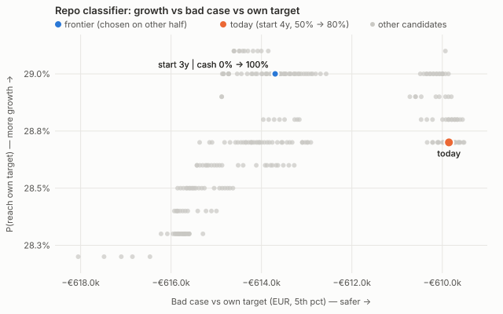
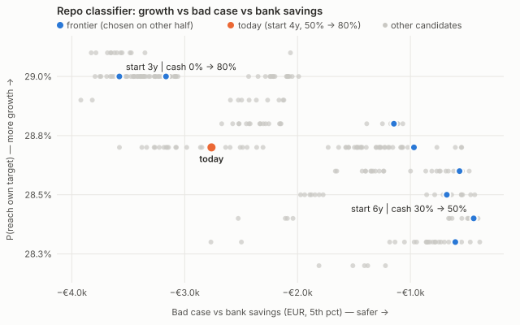
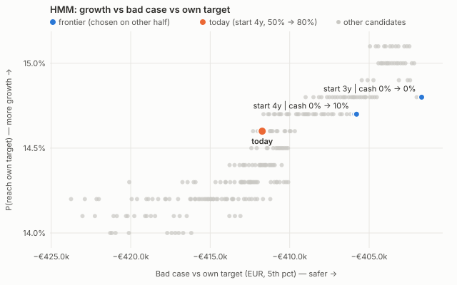
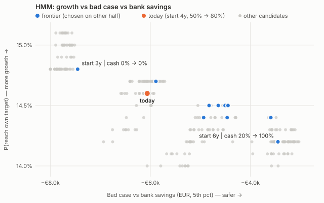

# Cash-conversion frontier: tables (generated)

Generated by `studies/report_cash_frontier.py` from `studies/output/`. Values are medians on the held-out half of the re-calibrations; the frontier was chosen on the other half. Method: METHODS.md §10.

## Repo classifier

264 candidates × 200 re-calibrations × 500 paths; params `params/nl_bootstrap.json` (sha256 02e877bd0502…), run 2026-11-11, 45 min.

### Safety = Bad case vs own target (EUR, 5th pct)

Frontier size selection/held-out: 1/5; overlap (Jaccard) 0.00; today on frontier: selection False, held-out False.

| Candidate | On held-out frontier | P(reach target) | Δ vs today, pp [5–95%] | Bad case | Δ vs today [5–95%] | Better on both (share of held-out re-cal.) |
|---|---|---|---|---|---|---|
| start 3y | cash 0% → 100% | no | 29.0% | +0.4 [-0.0, +1.6] | −€613.7k | €4.1k [−€2.8k, €11.9k] | 73% |
| start 4y | cash 50% → 80% **(today)** | no | 28.7% | +0.0 [+0.0, +0.0] | −€609.9k | €0.0k [€0.0k, €0.0k] | 0% |

### Safety = Bad case vs bank savings (EUR, 5th pct)

Frontier size selection/held-out: 8/8; overlap (Jaccard) 0.00; today on frontier: selection False, held-out False.

| Candidate | On held-out frontier | P(reach target) | Δ vs today, pp [5–95%] | Bad case | Δ vs today [5–95%] | Better on both (share of held-out re-cal.) |
|---|---|---|---|---|---|---|
| start 3y | cash 0% → 80% | no | 29.0% | +0.4 [-0.0, +1.8] | −€3.6k | −€0.7k [−€3.1k, €1.7k] | 29% |
| start 3y | cash 10% → 20% | no | 29.0% | +0.6 [+0.0, +1.8] | −€3.2k | −€0.4k [−€2.7k, €1.5k] | 38% |
| start 5y | cash 0% → 40% | no | 28.8% | +0.0 [-0.4, +0.6] | −€1.1k | €1.3k [€0.3k, €2.3k] | 42% |
| start 5y | cash 0% → 10% | no | 28.7% | +0.0 [-0.6, +0.8] | −€1.0k | €1.3k [€0.1k, €2.5k] | 45% |
| start 4y | cash 50% → 80% **(today)** | no | 28.7% | +0.0 [+0.0, +0.0] | −€2.8k | €0.0k [€0.0k, €0.0k] | 0% |
| start 6y | cash 0% → 30% | no | 28.6% | -0.2 [-0.8, +0.4] | −€0.6k | €1.9k [€0.2k, €3.2k] | 22% |
| start 6y | cash 20% → 70% | no | 28.5% | -0.4 [-1.2, +0.2] | −€0.7k | €1.8k [€0.3k, €3.3k] | 10% |
| start 6y | cash 30% → 50% | no | 28.4% | -0.4 [-1.4, +0.2] | −€0.4k | €2.0k [−€0.1k, €3.6k] | 10% |
| start 6y | cash 40% → 70% | no | 28.3% | -0.4 [-1.6, +0.2] | −€0.6k | €1.9k [−€0.4k, €3.8k] | 10% |

## HMM

264 candidates × 200 re-calibrations × 500 paths; params `params/nl_bootstrap_hmm.json` (sha256 439a989d7a21…), run 2026-11-11, 44 min.

### Safety = Bad case vs own target (EUR, 5th pct)

Frontier size selection/held-out: 3/3; overlap (Jaccard) 0.20; today on frontier: selection False, held-out False.

| Candidate | On held-out frontier | P(reach target) | Δ vs today, pp [5–95%] | Bad case | Δ vs today [5–95%] | Better on both (share of held-out re-cal.) |
|---|---|---|---|---|---|---|
| start 3y | cash 0% → 0% | yes | 14.8% | +0.6 [-0.2, +1.8] | −€401.7k | €4.4k [−€5.3k, €12.1k] | 67% |
| start 4y | cash 0% → 0% | no | 14.7% | +0.3 [+0.0, +1.2] | −€405.8k | €2.0k [−€2.3k, €7.4k] | 62% |
| start 4y | cash 0% → 10% | no | 14.7% | +0.2 [+0.0, +1.2] | −€405.9k | €1.9k [−€2.3k, €7.2k] | 61% |
| start 4y | cash 50% → 80% **(today)** | no | 14.6% | +0.0 [+0.0, +0.0] | −€411.7k | €0.0k [€0.0k, €0.0k] | 0% |

### Safety = Bad case vs bank savings (EUR, 5th pct)

Frontier size selection/held-out: 10/8; overlap (Jaccard) 0.12; today on frontier: selection False, held-out False.

| Candidate | On held-out frontier | P(reach target) | Δ vs today, pp [5–95%] | Bad case | Δ vs today [5–95%] | Better on both (share of held-out re-cal.) |
|---|---|---|---|---|---|---|
| start 3y | cash 0% → 0% | yes | 14.8% | +0.6 [-0.2, +1.8] | −€7.5k | −€1.7k [−€4.9k, €2.2k] | 20% |
| start 4y | cash 0% → 50% | no | 14.7% | +0.2 [-0.2, +1.0] | −€5.9k | −€0.0k [−€1.5k, €1.5k] | 40% |
| start 4y | cash 50% → 80% **(today)** | no | 14.6% | +0.0 [+0.0, +0.0] | −€6.1k | €0.0k [€0.0k, €0.0k] | 0% |
| start 5y | cash 0% → 0% | yes | 14.5% | +0.0 [-0.6, +0.8] | −€4.4k | €1.3k [−€0.6k, €3.0k] | 41% |
| start 5y | cash 0% → 20% | no | 14.5% | +0.0 [-0.6, +0.6] | −€4.5k | €1.4k [−€0.4k, €2.9k] | 42% |
| start 5y | cash 0% → 60% | no | 14.5% | +0.0 [-0.6, +0.6] | −€4.6k | €1.4k [−€0.0k, €3.0k] | 34% |
| start 5y | cash 0% → 80% | no | 14.5% | +0.0 [-0.6, +0.4] | −€4.8k | €1.3k [€0.2k, €2.8k] | 28% |
| start 6y | cash 0% → 90% | no | 14.4% | -0.2 [-1.2, +0.2] | −€3.6k | €2.4k [−€0.1k, €4.1k] | 16% |
| start 5y | cash 10% → 40% | no | 14.4% | +0.0 [-0.6, +0.4] | −€4.5k | €1.4k [−€0.1k, €2.8k] | 30% |
| start 5y | cash 10% → 80% | no | 14.4% | +0.0 [-0.6, +0.4] | −€4.9k | €1.4k [€0.2k, €2.4k] | 25% |
| start 6y | cash 20% → 100% | no | 14.2% | -0.4 [-1.6, +0.2] | −€3.4k | €2.6k [−€0.7k, €5.1k] | 13% |
